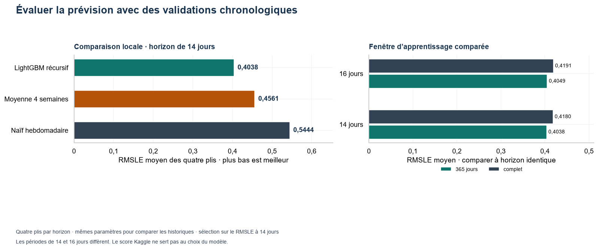
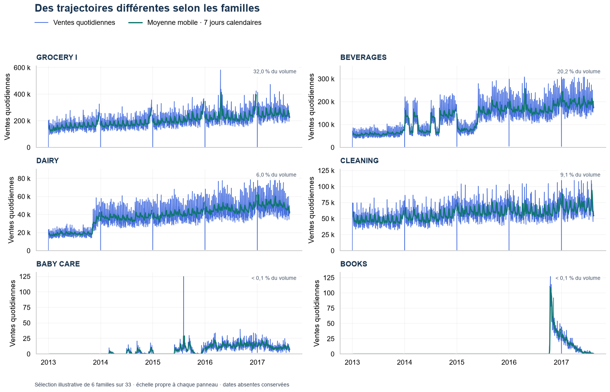
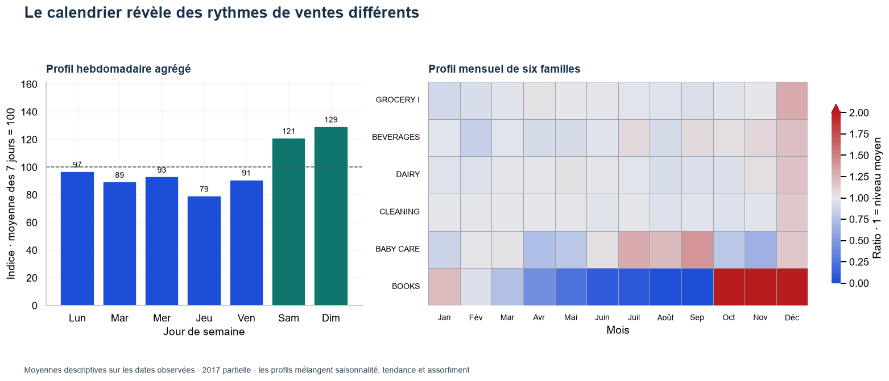
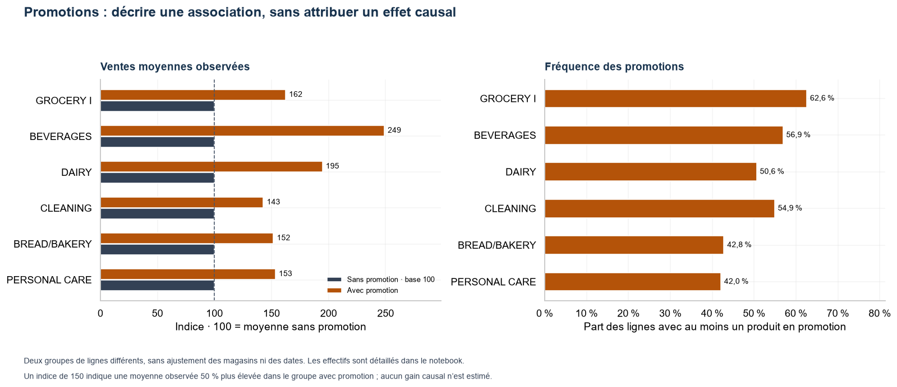
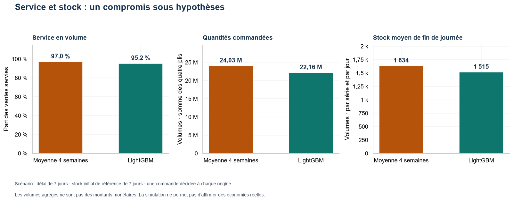

# Prévision des ventes et simulation de stock

> **In English.** Daily sales forecasting for 54 stores and 33 product families of an Ecuadorian retailer (Kaggle Store Sales, 3 million rows), from data audit to a recursive LightGBM model.
> Time-based backtesting gives a local RMSLE of 0.404 against 0.456 for a four-week weekday-average baseline; the accepted Kaggle submission scores 0.5888.
> The forecasts then drive an educational stock simulation comparing service level, orders and inventory. Personal project by Abdoulaye KONE.

**Portfolio Data Science · Analyse exploratoire · Séries temporelles · LightGBM**

Une étude des ventes de magasins équatoriens, du diagnostic des données à la prévision quotidienne par magasin et famille, puis à une simulation pédagogique de stock.

**[Ouvrir l’étude complète →](notebooks/00_projet_complet.ipynb)** · [Accéder aux données](LIENS.md) · [Consulter les décisions](DECISIONS.md)

| **Observations de ventes** | **Magasins** | **Familles** |  **Validation locale** |
| -------------------------------: | -----------------: | -----------------: | ---------------------------: |
| **3 000 888 observations** |       **54** |       **33** | **4 plis de 14 jours** |

**Lecture rapide :** [Résultats](#le-résultat-à-retenir) · [Exploration visuelle](#comprendre-les-données-avant-de-prévoir) · [Simulation de stock](#du-modèle-à-une-décision-de-stock-simulée) · [Parcours complet](#un-parcours-complet-dans-un-seul-notebook) · [Reproduction](#reproduire-létude)

## Le résultat à retenir

La moyenne des quatre semaines par jour de semaine sert de référence. Le modèle retenu est un **LightGBM récursif entraîné sur les 365 derniers jours**, avec une cible `log1p`, les promotions, le calendrier, des retards de 7, 14 et 28 jours et des moyennes mobiles de 7 et 28 jours.

| **Méthode**                                         | **RMSLE local moyen · 14 jours** |
| ---------------------------------------------------------- | --------------------------------------: |
| Moyenne des quatre semaines par jour de semaine            |                                  0,4561 |
| **LightGBM récursif · 365 jours d’apprentissage** |                        **0,4038** |

Le modèle améliore la précision locale face à la baseline. La figure compare les méthodes et les deux fenêtres d’apprentissage sur les mêmes plis. La fenêtre récente est retenue à partir du backtest de 14 jours ; le contrôle sur 16 jours évalue sa stabilité.



**Soumission Kaggle acceptée : RMSLE 0,58880**, avec 28 512 prévisions sur 16 jours.

> **Deux évaluations distinctes.** Les scores locaux et Kaggle portent sur des périodes différentes et ne sont pas directement comparables. Plus bas est meilleur. Kaggle fournit ici un score global ; les ventes réelles et erreurs individuelles du test ne sont pas connues.

## Comprendre les données avant de prévoir

Les ventes sont observées par **date × magasin × famille**, du **1er janvier 2013 au 15 août 2017**, soit **1 782 séries**. Elles représentent des volumes, pas du chiffre d’affaires.

Le notebook examine les **sept fichiers sources** : dictionnaire des variables, types, valeurs manquantes, doublons, clés de jointure et statistiques descriptives des variables numériques et catégorielles. Après le nettoyage, il présente les distributions, les ventes nulles, les trajectoires et les relations entre variables.

### Des familles aux trajectoires différentes

Les niveaux, les périodes actives et les variations diffèrent fortement selon les familles. Cette sélection montre six profils contrastés ; l’étude complète représente les **33 familles et 54 magasins**.



### Des rythmes calendaires à interpréter avec leur contexte

Les profils hebdomadaires et mensuels rendent les différences visibles. Les moyennes mélangent saisonnalité, tendance et changements d’assortiment ; l’année 2017 est partielle.



### Promotions : une association descriptive

La comparaison distingue le niveau moyen des ventes et la fréquence des promotions. Les groupes ne sont pas ajustés sur les magasins ou les dates : **aucun effet causal des promotions n’est estimé**.



Le pétrole, les transactions et les événements sont également étudiés dans le notebook. Le pétrole et les transactions ne sont pas utilisés comme prédicteurs futurs sans disponibilité garantie à l’origine de prévision.

## Du modèle à une décision de stock simulée

Le scénario de référence compare les méthodes avec un délai hypothétique de sept jours et un même stock initial de référence. Une commande est décidée au début de chaque pli ; les ventes non servies sont perdues dans le scénario.



Dans ce scénario, LightGBM commande et conserve moins de stock, avec un service simulé d’environ **95,2 %**, contre **97,0 %** pour la baseline. Ce résultat dépend des hypothèses. L’analyse de sensibilité compare aussi des délais de 5 et 10 jours et plusieurs niveaux de stock initial.

> **Limite métier.** Les données ne fournissent ni stocks historiques, ni ruptures observées, ni délais fournisseurs, ni coûts réels. Le service simulé doit être lu avec les commandes et le stock. Il ne démontre ni une supériorité générale d’une méthode ni des économies réelles.

## Un parcours complet dans un seul notebook

Le [notebook principal](notebooks/00_projet_complet.ipynb) contient **22 étapes et 66 figures**, avec les calculs, les tableaux détaillés et les interprétations. Les sorties enregistrées permettent une lecture sans réentraînement. Les cinq figures de ce README donnent un aperçu de cette étude.

| **Partie**           | **Contenu**                                                              | **Accès**                                              |
| -------------------------- | ------------------------------------------------------------------------------ | ------------------------------------------------------------- |
| **01 · Cadrer**     | Question métier, environnement et dictionnaire des sept fichiers              | [Étapes 1–3](notebooks/00_projet_complet.ipynb#section-1)    |
| **02 · Fiabiliser** | Diagnostic, nettoyage, contrôles et statistiques de toutes les variables      | [Étapes 4–8](notebooks/00_projet_complet.ipynb#section-4)    |
| **03 · Explorer**   | Ventes, familles, magasins, promotions, transactions, pétrole et événements | [Étapes 9–14](notebooks/00_projet_complet.ipynb#section-9)   |
| **04 · Prévoir**   | Validation chronologique, baselines, variables, LightGBM et erreurs            | [Étapes 15–19](notebooks/00_projet_complet.ipynb#section-15) |
| **05 · Simuler**    | Service, commandes, stock et analyse de sensibilité                           | [Étape 20](notebooks/00_projet_complet.ipynb#section-20)      |
| **06 · Restituer**  | Soumission contrôlée, bilan, limites et perspectives                         | [Étapes 21–22](notebooks/00_projet_complet.ipynb#section-21) |

### Les choix qui rendent l’évaluation interprétable

- **Calendrier quotidien réel** : les 25 décembre 2013 à 2016 sont absents ; une date inconnue n’est pas remplacée par une vente nulle.
- **Prévisions sans lecture des ventes futures** : apprentissage avant chaque origine, baselines figées et prévisions récursives réutilisées pendant l’horizon.
- **Même protocole pour comparer les méthodes** : RMSLE, MAE, WAPE, biais et volumes, par pli et par groupe. Pour les petites familles comme Books, le WAPE se lit avec le volume et la MAE.
- **Sélection locale explicite** : comparaison de 365 jours et de tout l’historique. À 16 jours, RMSLE moyen de 0,4049 contre 0,4191. Les plis ayant servi au choix ne constituent pas un test final indépendant.

<details>
<summary><strong>Historique des soumissions Kaggle</strong></summary>

| **Version**              | **Configuration**                            | **RMSLE Kaggle** |
| ------------------------------ | -------------------------------------------------- | ---------------------: |
| Première soumission acceptée | Historique complet, avant correction du calendrier |                0,60824 |
| Deuxième soumission acceptée | 365 jours et variables en jours calendaires        |      **0,58880** |

Réduction de 0,01944, soit environ 3,2 %. Elle concerne la configuration dans son ensemble ; elle ne permet pas d’isoler l’effet de chaque correction. Ces scores sont ceux attribués par Kaggle à chaque soumission.

</details>

## Reproduire l’étude

**Environnement de référence : Python 3.12**, avec les versions de [requirements.txt](requirements.txt). Le notebook s’exécute de haut en bas depuis les fichiers bruts ; aucun notebook intermédiaire ou CSV préparé n’est requis.

Les données ne sont pas incluses dans le dépôt. Télécharger les fichiers de la [compétition Kaggle](https://www.kaggle.com/competitions/store-sales-time-series-forecasting), puis placer les sept CSV dans `data/raw/store-sales-time-series-forecasting/` : `train.csv`, `test.csv`, `stores.csv`, `holidays_events.csv`, `oil.csv`, `transactions.csv` et `sample_submission.csv`.

<details>
<summary><strong>Installation et téléchargement sous Windows / PowerShell</strong></summary>

Depuis la racine du projet, créer un environnement virtuel, ignoré par Git :

```powershell
py -3.12 -m venv .venv
.\.venv\Scripts\Activate.ps1
python -m pip install -r requirements.txt
```

Après acceptation des règles Kaggle et configuration des identifiants hors du dépôt :

```powershell
kaggle competitions download -c store-sales-time-series-forecasting -p data/raw
Expand-Archive -LiteralPath data/raw/store-sales-time-series-forecasting.zip -DestinationPath data/raw/store-sales-time-series-forecasting
```

Sélectionner l’interpréteur dans VS Code, ouvrir `notebooks/00_projet_complet.ipynb` et exécuter toutes les cellules. L’étude comprend seize entraînements de backtest et un entraînement final ; la durée dépend de la machine.

</details>

Les exports de CSV sont **désactivés par défaut** (`EXPORTER_FICHIERS = False`). Les fichiers existants sont conservés tant que `ECRASER_EXPORTS` reste désactivé. Les données brutes, les CSV générés et les identifiants Kaggle restent locaux, selon les règles de [.gitignore](.gitignore).

### Organisation du dépôt public

```text
.
├── README.md
├── notebooks/
│   └── 00_projet_complet.ipynb
├── rapports/
│   └── figures/                 cinq figures de présentation
├── requirements.txt
├── .gitattributes
├── .gitignore
├── LIENS.md
├── DECISIONS.md
└── LICENSE
```

## Prochaines questions à tester

Mesurer séparément l’apport des événements et des caractéristiques magasin, comparer prévisions récursives et directes, réserver une période finale après sélection et calibrer l’incertitude à partir d’erreurs disponibles avant l’origine. Une simulation opérationnelle nécessiterait ensuite des stocks, délais et coûts réels.

**Sources :** [Kaggle Store Sales](https://www.kaggle.com/competitions/store-sales-time-series-forecasting) · [Accès et références](LIENS.md) · [Décisions méthodologiques](DECISIONS.md)

## Licence

Le code et l’analyse sont publiés sous [licence MIT](LICENSE). Les données de la compétition ne sont pas redistribuées : elles restent soumises aux [règles Kaggle](https://www.kaggle.com/competitions/store-sales-time-series-forecasting/rules).

---

**Auteur : Abdoulaye KONE**, projet personnel  
*Portfolio Data Science — Prévision des ventes et simulation de stock*  
[LinkedIn](https://linkedin.com/in/abdoulaye-kone) · [GitHub](https://github.com/abdoul4Kone)
